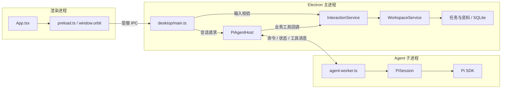

# Orbit Repository Map

更新日期：2026-10-18。

本文回答三个问题：每个模块负责什么、模块里的代码文件做什么、修改某项功能应该从哪里开始。按当前工作区核对，包含 Pi SDK、模型配置后端与 Room 后端 / 统一入口 UI；历史业务链路 HTML 的基线另见文档索引。

仓库目前只有一个 npm 包：根目录 [package.json](../package.json) 定义的 `orbit-desktop`。`src/` 下的目录是这个包内部的逻辑模块，尚未拆成独立发布的 workspace packages。

运行与配置见 [README](../README.md)，产品目标见 [PRODUCT.md](PRODUCT.md)，架构取舍与完成边界见 [ARCHITECTURE.md](ARCHITECTURE.md)。本页以源码定位为主。

## 1. 目录总览

```text
Orbit/
├── src/
│   ├── contracts.ts          界面与主进程共享的数据和接口契约
│   ├── renderer/             React 页面、输入、语音采集与播放
│   ├── desktop/              Electron 主进程、预加载桥接、Agent 子进程入口
│   ├── application/          Orbit 交互规则与业务用例编排
│   ├── domains/
│   │   ├── conversation/     Agent 运行接口、业务工具契约、需求回执
│   │   ├── tasks/            需求校验、任务存取与取消规则
│   │   ├── materials/        附件导入、副本与元信息
│   │   ├── models/           模型配置契约、provider 注册与验证
│   │   └── voice/            Qwen 实时语音、本地唤醒检测
│   └── infrastructure/
│       ├── database.ts       SQLite 建表、版本检查、事务
│       ├── history/          按 session 归档、迁移、文件检索与分页读取
│       ├── models/           配置文件、系统密钥保护、Codex 只读凭据
│       └── pi/               Pi SDK 适配、会话与子进程通信
├── public/                   浏览器侧静态资源，目前为音频采集 worklet
├── assets/voice/             本地唤醒词、模型资源与许可说明
├── scripts/                  开发、构建、模型准备、桌面及语音验证
├── tests/                    业务、Pi 会话、进程、语音测试及本机模型桩
├── docs/                     产品、架构、源码地图与历史 HTML
└── .github/workflows/        持续集成
```

运行时主要分为三个进程：React 渲染进程、Electron 主进程、Pi Agent 子进程。SQLite 和附件操作由主进程持有，Pi SDK 由 Agent 子进程加载，界面通过 `window.orbit` 调用应用能力。

当前模块也包含实际存储和协议实现：`TaskRepository` 直接使用 SQLite，`MaterialLibrary` 操作文件和数据库，`domains/voice` 接入 WebSocket 与原生唤醒库。读代码时应按这些实际依赖定位。

## 2. 源码文件职责

### 2.1 共享契约：`src/contracts.ts`

| 文件 | 主要定义 | 职责与使用方 |
| --- | --- | --- |
| [contracts.ts](../src/contracts.ts) | `Attachment`、`Message`、`Task`、`SubmitRequest`、`Workspace`、`Conversation`、`OrbitApi`、`VoiceEvent` | 定义界面、预加载、主进程共同使用的可序列化数据。`Workspace` 是业务数据视图，`Conversation` 用于旧 Pi 投影及新的 Room 分页视图；`OrbitApi` 是 `window.orbit` 的接口。新增跨进程字段或界面能力先核对这里。 |

`Task.status` 当前只有 `pending` 和 `canceled`；`Conversation.status` 的 `running` 表示模型正在回复，与任务执行状态无关。

### 2.2 页面模块：`src/renderer/`

运行在 Electron 的渲染进程。使用 React 和浏览器 API，通过预加载接口读取业务数据。

| 文件 | 入口 / 对象 | 具体负责什么 |
| --- | --- | --- |
| [main.tsx](../src/renderer/main.tsx) | React 根节点 | 加载全局样式，将 `App` 挂载到 HTML 的 `root`，启用 `StrictMode`。 |
| [App.tsx](../src/renderer/App.tsx) | `App` | 主入口、侧栏、对话输入、流式回复、附件选择、文件页、任务详情与取消、设置页和语音面板。通过 `useRoom` 展示唯一的 Room 时间线和历史翻页，保持阅读位置，显示语音来源与中断状态，处理“发送消息”和“仅保存需求”两种入口。通过 `useModelSettings` 保持模型操作状态，挂载独立模型设置组件。当前页面组装主要集中在本文件。 |
| [TaskBoard.tsx](../src/renderer/TaskBoard.tsx) | `TaskBoard` | 任务看板 / 列表切换、搜索、状态筛选、任务卡片及选中回调。数据由 `App` 传入，不直接查询数据库。 |
| [ModelSettings.tsx](../src/renderer/ModelSettings.tsx) | `ModelSettings` | 当前文字模型、配置列表与搜索、来源和登录状态、连接测试结果、启用 / 删除 / 编辑及焦点恢复。入口在设置页和主入口输入框下方。 |
| [ModelProfileForm.tsx](../src/renderer/ModelProfileForm.tsx) | `ModelProfileForm` | API / 本地订阅表单、服务选择、写入密钥、自定义地址与容量、仅保存 / 保存并启用；相同服务地址下留空保留密钥，更换来源或地址要求新密钥。 |
| [ModelPicker.tsx](../src/renderer/ModelPicker.tsx) | `ModelPicker` | 按 provider 加载并搜索目录，保留当前选择及失效条目，隔离迟到请求，提供加载失败重试；账号权限由显式连接测试验证。 |
| [useModelSettings.ts](../src/renderer/useModelSettings.ts) | `useModelSettings` | App 级配置状态、IPC 事件订阅、过期读取隔离、操作互斥、独立登录检测和测试结果。区分保存失败与保存成功后启用失败，导航时保持未完成操作。 |
| [model-settings.css](../src/renderer/model-settings.css) | 模型页面 CSS | 当前模型、配置卡片、表单、目录选择、状态和响应式样式，限定在模型组件内。 |
| [useRoom.ts](../src/renderer/useRoom.ts) | `useRoom` | 订阅 Room 最近页，按消息 ID 合并并按 seq 排序，保留已加载旧页，防止初始 read 覆盖实时事件，管理旧页 cursor 与读取互斥。 |
| [useVoice.ts](../src/renderer/useVoice.ts) | `useVoice` | 获取麦克风、启动 AudioWorklet、经 IPC 发送音频帧；播放服务端 24 kHz PCM 音频，管理播放队列、打断和资源释放；文字回复时关闭麦克风 track 与帧上传，语音就绪后恢复，手动切回语音复用麦克风；generation 隔离迟到的采集 / IPC 错误。转写由 Room 时间线展示。 |
| [styles.css](../src/renderer/styles.css) | 全局 CSS | 桌面布局、侧栏、对话、输入框、任务看板、文件、设置、语音面板、弹窗及响应式样式。 |
| [global.d.ts](../src/renderer/global.d.ts) | `Window.orbit` | 把 `OrbitApi` 声明到浏览器全局类型，只提供 TypeScript 类型，不创建运行时接口。 |

`TaskBoard` 展示了“进行中 / 待验收 / 已完成”等预留列；后端目前只能产生待派发和已取消任务。增加列本身不会增加执行能力。

### 2.3 桌面与进程入口：`src/desktop/`

| 文件 | 运行位置 | 具体负责什么 |
| --- | --- | --- |
| [main.ts](../src/desktop/main.ts) | Electron 主进程 | 应用装配入口：读取 `.env`、确定数据目录、打开数据库、创建资料 / 工作空间 / 交互 / 模型配置服务和 `PiAgentHost`；注入 `safeStorage`、配置仓储与 Codex 凭据，校验 IPC 来源；启动窗口与菜单，处理文件选择、麦克风权限、语音与唤醒；通过 `utilityProcess.fork` 启动 Pi worker，退出时关闭 Agent 和数据库。 |
| [preload.ts](../src/desktop/preload.ts) | 预加载隔离上下文 | 用 `contextBridge` 暴露有限的 `window.orbit` 接口，包含 `models` 配置 API 和 `room.read / room.onChanged`；方法映射为 IPC 请求，对话 / 模型配置 / 语音事件映射为订阅，并提供取消订阅函数。不返回密钥。 |
| [agent-worker.ts](../src/desktop/agent-worker.ts) | 独立 Agent 子进程 | 接收会话、配置切换、模型目录和连接测试命令，调用 `PiSession` 或模型运行时，回传状态和响应。业务工具和凭据读取经内部 RPC 转给主进程；支持 Electron `parentPort`，也支持测试使用的 Node IPC。 |

### 2.4 业务用例：`src/application/`

这一层定义 Orbit 如何使用 Agent，以及业务动作如何落地。增加产品能力时，先确定应用层用例与领域规则，再接入 SDK 工具。

| 文件 | 主要定义 | 具体负责什么 |
| --- | --- | --- |
| [interaction.ts](../src/application/interaction.ts) | `INTERACTION_PROMPT`、`INTERACTION_TOOLS`、`InteractionService` | 定义常驻交互 Agent 的身份、职责和 `list_tasks / save_request / read_history / search_history` 工具参数。`prepare` 校验输入并解析附件元信息；`execute` 分派业务工具，限制可关联的附件，用 room ID 和轮次 ID 生成稳定去重键，再调用 `WorkspaceService`。这里不导入 Pi SDK。 |
| [room.ts](../src/application/room.ts) | `RoomService` | 串行化文字 / 语音输入，维护 generation，归档可见消息和回执，向 Pi / Qwen 注入最近历史，验证工具归属，控制切换、暂停、恢复与退出；不加载 Pi SDK。 |
| [workspace.ts](../src/application/workspace.ts) | `WorkspaceService` | `snapshot` 汇总任务、附件和业务消息；`submit` 支持手动保存；`saveRequest` 在事务中校验附件、去重、创建待派发任务并写系统回执；`cancelTask` 调用任务取消规则。Agent 保存只写业务回执，直接保存还写用户输入消息。 |
| [models.ts](../src/application/models.ts) | `ModelConfigurationService` | 读取 / 保存 / 删除多套模型配置，激活和测试；控制环境兼容优先级、回复中的变更限制、运行时切换及保存失败回滚。对外生成无凭据视图，对 worker 按需解析凭据。通过内部端口使用存储和运行时，不导入 Electron / Pi。 |

### 2.5 对话契约与回执：`src/domains/conversation/`

| 文件 | 主要定义 | 具体负责什么 |
| --- | --- | --- |
| [agent.ts](../src/domains/conversation/agent.ts) | `AgentInput`、`BusinessTool`、`ToolContext`、`ExecuteTool`、`AgentRuntime` | 定义 Orbit 自己的 Agent 接口、工具描述及执行上下文。`AgentRuntime` 提供读取、发送、中断和关闭方法；适配层实现这些接口，业务代码不需要持有 Pi 的对象。 |
| [history.ts](../src/domains/conversation/history.ts) | `RoomHistory`、`HistoryContext`、`HISTORY_TOOLS`、`projectPiHistory` | 定义共享历史端口、工具 schema、上下文预算、Pi 可见消息投影；Pi 运行适配和旧数据迁移共用投影。 |
| [intake.ts](../src/domains/conversation/intake.ts) | `intakeReceipt` | 根据已保存任务生成明确的系统回执及任务关联，说明需求仅保存在本机、尚未派发。由 `WorkspaceService` 调用，不发起模型请求。 |

### 2.6 任务：`src/domains/tasks/`

| 文件 | 主要定义 | 具体负责什么 |
| --- | --- | --- |
| [task.ts](../src/domains/tasks/task.ts) | `validateRequest`、`cancelPendingTask` | 校验请求 ID、文字长度、附件数量与重复项，拒绝空需求；定义待派发任务的取消规则，重复取消保持幂等。这是业务输入与状态转换规则入口。 |
| [repository.ts](../src/domains/tasks/repository.ts) | `TaskRepository` | 在 SQLite 中列出任务、按请求 ID 查重、创建任务、读取并更新取消结果。状态转换委托给 `cancelPendingTask`，创建事务由应用层控制。 |

### 2.7 附件资料：`src/domains/materials/`

| 文件 | 主要定义 | 具体负责什么 |
| --- | --- | --- |
| [library.ts](../src/domains/materials/library.ts) | `MaterialLibrary` | `list` 返回附件元信息，`require` 按 ID 获取元信息及内部存储路径，`importFile` 校验类型和 25 MB 大小限制、复制文件并保存数据库记录；写库失败时清理副本。文件内容解析、OCR 和知识检索尚未实现。 |

文件选择器在 `desktop/main.ts`，文件导入规则在 `MaterialLibrary`。模型目前只收到附件 ID、名称和大小；本机路径留在主进程内使用。

### 2.8 语音：`src/domains/voice/`

| 文件 | 主要定义 | 具体负责什么 |
| --- | --- | --- |
| [realtime.ts](../src/domains/voice/realtime.ts) | `RealtimeVoice` | 建立 Qwen WebSocket 会话，接收 Room 注入的提示词、四个工具和最近历史，等待历史 item 确认后上传音频；关联用户 item / response / tool call，等待异步工具结果，隔离旧 socket，归档已收到的中断转写。 |
| [wake.ts](../src/domains/voice/wake.ts) | `WakeDetector` | 加载本地 sherpa-onnx 关键词模型，把 16 kHz PCM 转为识别输入，返回是否命中唤醒词。模型缺失时提示运行安装脚本；本文件不建立云端连接。 |

语音和文字共用 `application/interaction.ts` 的工具定义与分派，经 `RoomService` 校验轮次。两条通道保留各自模型运行会话，以稳定 room 串联可见历史。

### 2.9 数据与 Pi 适配：`src/infrastructure/`

| 文件 | 主要定义 | 具体负责什么 |
| --- | --- | --- |
| [history/store.ts](../src/infrastructure/history/store.ts) | `FileRoomHistory` | 每 session JSONL、稳定消息 ID / seq、最近上下文、摘要、旧 Pi / 回执迁移、索引与损坏恢复；按文件名查找、调用包内 ripgrep 检索、按行 / 字节分页读取，拒绝越界路径。 |
| [database.ts](../src/infrastructure/database.ts) | `openDatabase`、`transaction` | 使用 `node:sqlite` 打开数据库，检查 `user_version`，建立任务、消息和附件表，配置 WAL / 外键 / 等待超时；提供 `BEGIN IMMEDIATE` 事务及回滚。当前建表与版本逻辑都集中在本文件。 |
| [models/store.ts](../src/infrastructure/models/store.ts) | `FileModelRepository`、`protectedSecrets` | 校验 / 原子读写版本化 `models.json`，保护已有损坏文件；包装主进程注入的 Electron `safeStorage` 加解密，拒绝无系统保护的明文降级。 |
| [models/codex.ts](../src/infrastructure/models/codex.ts) | `LocalCodexCredentials` | 只读指定 `CODEX_HOME` 下的 `auth.json`，检查大小、ChatGPT 登录格式、account claim 与有效期。提供无 token 的检测状态，调用时返回 access token；不导入 refresh token、不登录 / 刷新 / 回写。 |
| [models/environment.ts](../src/infrastructure/models/environment.ts) | `environmentProfile` | 将旧 `ORBIT_AGENT_*` 配置投影为只读模型配置；仅在从未保存配置文件时生效。 |
| [pi/protocol.ts](../src/infrastructure/pi/protocol.ts) | `AgentSetup`、`AgentCommand`、`AgentResponse`、`ParentMessage`、`WorkerMessage`、`AgentProcess` | 定义主进程与 worker 的初始化、会话、配置切换 / 目录 / 测试、工具调用及内部凭据 RPC。内部凭据消息不进入 renderer IPC。 |
| [pi/host.ts](../src/infrastructure/pi/host.ts) | `PiAgentHost` | 实现 `AgentRuntime` 与 `ModelRuntimePort`：延迟启动、请求关联、缓存状态、超时和崩溃恢复、停止关闭；控制发送 / 模型操作互斥，校验工具轮次与凭据配置 ID 后调用主进程服务。本文件不加载 Pi SDK。 |
| [pi/models.ts](../src/infrastructure/pi/models.ts) | `modelCatalog`、`createModelRuntime`、`testModelConnection`、`modelFailure` | 使用 Pi 内置目录与协议，创建隔离的内存运行时、按需凭据解析、自定义端点与 OpenRouter 适配；单次无工具连接测试，统一对外错误。不注册 Codex OAuth 刷新能力。 |
| [pi/session.ts](../src/infrastructure/pi/session.ts) | `PiSession` | Pi 会话创建 / 恢复、资源和工具白名单、流式事件投影、停止和错误处理；空闲时切换模型并复用 `SessionManager`，发送前重新校验凭据。Pi JSONL 与自定义轮次条目保留上下文、附件关联和去重；附件只拼入元信息。 |

Pi 的调用循环、模型协议、上下文管理和会话能力来自安装的 SDK。Orbit 自己维护业务工具、任务状态、桌面桥接和适配层；仓库中没有复制的 Pi `coding-agent` 源码目录。

### 2.10 模型配置领域：`src/domains/models/`

| 文件 | 主要定义 | 具体负责什么 |
| --- | --- | --- |
| [model.ts](../src/domains/models/model.ts) | `ModelProfile`、`ModelsApi`、`ModelConfigurationState` 和内部端口 | 定义 API / Codex 来源、配置视图、目录、检测和连接结果；对外写入参数与内部存储 / 凭据分开。声明配置仓储、密钥保护、Codex 读取与模型运行时端口。 |
| [providers.ts](../src/domains/models/providers.ts) | `PROVIDERS`、`providerDefinition`、`validateProfile`、`modelUnavailableReason` | 注册 provider、协议、凭据类型和端点能力；校验可保存字段；维护已确认的 Codex 订阅模型退役策略，供目录和激活流程共用，同时允许旧配置读取 / 编辑。 |

## 3. 主要调用链

### 3.1 文字对话与业务工具



发送入口是 `App → window.orbit.sendMessage → conversation:send`。主进程先调用 `InteractionService.prepare`，再由 `RoomService.send` 串行化通道并提供最近历史，交给 `PiAgentHost.send` 和子进程中的 `PiSession.send`。

模型调用工具时，`PiSession → worker → host → RoomService.execute → InteractionService.execute → WorkspaceService / FileRoomHistory`；结果按原路返回模型。对话状态由 worker 推送到主进程，再经 `conversation:state` 到页面。页面通过 `room:state` / `room:read` 读取统一投影，工作空间只提供任务和附件；不再拼接第二份回执。

### 3.2 直接保存、取消与附件

| 用户操作 | 调用链 | 结果 |
| --- | --- | --- |
| 仅保存需求 | `App → orbit.submit → workspace:submit → WorkspaceService.submit / saveRequest` | 不调用模型；在一个事务内保存任务、用户输入和系统回执。 |
| 取消待派发任务 | `App → orbit.cancelTask → task:cancel → WorkspaceService → TaskRepository → cancelPendingTask` | 更新为 `canceled`，返回最新工作空间。 |
| 添加附件 | `App → orbit.pickAttachments → materials:pick → 系统选择器 → MaterialLibrary.importFile` | 导入副本并返回元信息；关联到需求发生在保存需求时。 |
| 打开附件 | `App → orbit.openAttachment → materials:open → MaterialLibrary.require → shell.openPath` | 按附件 ID 打开本机副本。 |
| 停止文字回复 | `App → orbit.stopReply → conversation:abort → PiAgentHost → PiSession.abort` | 中断当前模型回复，保留已经提交的任务。 |

### 3.3 语音与唤醒

1. `useVoice` 获取麦克风，加载 [voice-capture.js](../public/voice-capture.js)，采集单声道 16 kHz PCM，按 640 个采样点分帧。
2. 音频经 `orbit.voiceAudio → voice:audio` 到主进程；待唤醒时送给 `WakeDetector`，命中后启动 `RealtimeVoice`。直接开始语音时跳过唤醒阶段。
3. `RealtimeVoice` 连接 Qwen，接收转写、音频和工具调用；业务工具由 `RoomService` 校验轮次后调用统一的 `InteractionService`。
4. 主进程通过 `voice:event` 返回事件，`useVoice` 展示转写、播放音频、响应打断并刷新任务数据。

语音协议不经过 `PiSession`，业务工具经过统一的 `InteractionService.execute`。文字和语音共享 Room 最近上下文、历史工具、任务与附件引用。转写写入文件；中断和重连不改变 room ID。

### 3.4 模型配置与凭据

`window.orbit.models → models:* IPC → ModelConfigurationService`，由应用服务调用配置仓储和模型运行时端口。激活时 `PiAgentHost → worker → PiSession.configure` 重建模型适配，保留同一个 Pi 会话；连接测试直接调用 `testModelConnection`，不创建会话或业务工具。

worker 需要凭据时走 `credential → host → ModelConfigurationService.credential`，由主进程解密 API key 或只读 Codex 登录，再通过内部响应返回。renderer 只收到配置视图和安全错误。支持范围、选择优先级和 UI 接口见 [MODEL_PROVIDERS.md](MODEL_PROVIDERS.md)。

## 4. 状态与数据放在哪里

默认根目录是 Electron 的 Orbit `userData`；可通过 `ORBIT_DATA_DIR` 覆盖。具体创建位置见 [main.ts](../src/desktop/main.ts)。

| 数据 | 位置 / 持有方 | 谁负责读写 |
| --- | --- | --- |
| 任务与请求去重键 | `<userData>/orbit.sqlite` 的 `tasks` 表 | `WorkspaceService` 编排，`TaskRepository` 存取。 |
| 系统回执、直接保存入口的用户消息 | 同一 SQLite 的 `messages` 表 | `WorkspaceService`；与任务创建一起提交。 |
| 附件元信息与内部路径 | 同一 SQLite 的 `attachments` 表 | `MaterialLibrary`。 |
| 附件文件副本 | `<userData>/attachments/` | `MaterialLibrary` 导入，主进程按 ID 打开。 |
| Pi 模型消息、工具结果、会话树和压缩记录 | `<userData>/rooms/main/runtime/pi/sessions/` 下的原生 JSONL | `PiSession` 使用 Pi `SessionManager` 管理。 |
| Orbit 文字轮次 ID、输入、附件关联和结束状态 | 同一 Pi 会话中的 `orbit.interaction-turn.v1` 自定义条目 | `PiSession`；重启时把未正常结束的轮次标为中断。 |
| Room 可见消息与每 session 摘要 | `<userData>/rooms/main/history/` | `FileRoomHistory`，经 `RoomService` 接收 Pi / Qwen 消息和 SQLite 回执。 |
| Room 索引和 provider session 映射 | `<userData>/rooms/main/room.json` | `FileRoomHistory` 原子写入，损坏时从历史重建。 |
| 当前流式草稿、页面选择、未完成转写和播放队列 | 进程 / 页面内存 | `PiSession`、`PiAgentHost`、`App`、`useVoice` 各自持有对应状态。 |
| 模型配置、active ID、加密 API key | `<userData>/models.json` | `ModelConfigurationService` 编排，`FileModelRepository` 原子持久化，`safeStorage` 加解密。 |
| 本地 Codex 登录 | `CODEX_HOME/auth.json`，默认 `~/.codex/auth.json` | Codex 拥有并更新；Orbit 主进程仅按需只读有效 access token，不复制 / 刷新 / 回写。 |
| 旧文字模型环境配置、Qwen 语音凭据 | 本机环境变量 / `.env` | 主进程加载；旧文字配置只在没有 `models.json` 时生效。凭据不发送到界面。 |

SQLite 中的业务任务与 Pi 会话分别持久化，没有跨两种存储的统一事务。已保存任务以 SQLite 为准；模型停止或进程退出不会回滚已提交任务。恢复逻辑避免自动重放已经接收的轮次。

## 5. 静态资源、构建与配置

### 5.1 根目录配置文件

| 文件 | 职责 |
| --- | --- |
| [package.json](../package.json) | 唯一 npm 包的名称、Node 版本要求、依赖和命令入口；Electron 启动入口是 `dist-electron/main.cjs`。 |
| [package-lock.json](../package-lock.json) | 锁定完整依赖树，用于 `npm ci` 重现安装；依赖变更由 npm 更新。 |
| [tsconfig.json](../tsconfig.json) | TypeScript 严格检查、JSX 和模块解析配置，覆盖 `src`、`tests` 与 Vite 配置；本身不生成产物。 |
| [vite.config.ts](../vite.config.ts) | React 网页构建与开发服务器，使用相对资源路径，开发地址固定为 `127.0.0.1:5173`。 |
| [index.html](../index.html) | 页面 HTML 入口、React 挂载节点及内容安全策略，加载 `src/renderer/main.tsx`。 |
| [.env.example](../.env.example) | 文字模型和 Qwen 语音的环境变量模板；配置解释见 README。 |
| [.gitignore](../.gitignore) | 忽略依赖、构建结果、验证产物、本地配置和下载的语音模型。 |
| [.github/workflows/check.yml](../.github/workflows/check.yml) | push / pull request 时在 Ubuntu、Node 22 上运行 `npm ci` 和 `npm run check`。桌面与真实语音测试需另行运行。 |

### 5.2 静态资源文件

| 文件 / 资源 | 职责 |
| --- | --- |
| [public/voice-capture.js](../public/voice-capture.js) | 浏览器 AudioWorklet，将麦克风浮点采样转为 16 kHz、16 位小端 PCM 帧，传给 `useVoice`。 |
| [assets/voice/keywords.txt](../assets/voice/keywords.txt) | “Hey Orbit”的发音 token、唤醒分数与阈值配置，由 `WakeDetector` 加载。 |
| [assets/voice/NOTICE.txt](../assets/voice/NOTICE.txt) | 记录唤醒库、模型来源、版本、校验方式与实现参考。 |
| [assets/voice/licenses/onnxruntime-LICENSE](../assets/voice/licenses/onnxruntime-LICENSE) | ONNX Runtime 许可文本。 |
| [assets/voice/licenses/sherpa-onnx-LICENSE](../assets/voice/licenses/sherpa-onnx-LICENSE) | sherpa-onnx 许可文本。 |
| `assets/voice/encoder.onnx`、`decoder.onnx`、`joiner.onnx`、`tokens.txt` | 安装脚本下载生成的唤醒模型与词表，已在 Git 中忽略；源代码目录存在不代表模型已经安装。 |

### 5.3 脚本文件

| 文件 | 入口 | 具体负责什么 |
| --- | --- | --- |
| [scripts/dev.mjs](../scripts/dev.mjs) | `npm run dev` | 先构建 Electron 代码，再启动 Vite 和 Electron，注入 `ORBIT_DEV_URL`，在退出时回收进程。页面支持热更新；Electron 及其依赖代码修改后要重启。 |
| [scripts/build-electron.mjs](../scripts/build-electron.mjs) | `npm run build` 的 Electron 阶段 | 用 esbuild 生成 `main.cjs`、`preload.cjs` 和独立 ESM `agent-worker.mjs`。worker 的 npm 包保持外部依赖，保留 Pi 包自身的运行资源。 |
| [scripts/setup-voice.mjs](../scripts/setup-voice.mjs) | `npm run setup:voice` | 下载固定版本的关键词模型压缩包，校验 SHA-256，解压指定文件到 `assets/voice/`，清理临时目录。 |
| [scripts/smoke.mjs](../scripts/smoke.mjs) | `npm run test:desktop` | 用 Playwright 启动真实 Electron 和 Pi worker，以临时数据目录和本机模型桩验证聊天、工具保存、取消、重启恢复、停止、未配置模型时直接保存，以及语音设置入口。截图保存在 `artifacts/`。 |
| [scripts/room-ui-smoke.mjs](../scripts/room-ui-smoke.mjs) | `npm run test:desktop` 的第三阶段 | 真实 Electron / preload / Room / Pi，离线控制语音状态与模拟麦克风：统一历史、翻页位置、回执去重、旧页保留、暂停和手动切回、旧音频错误隔离、资源释放。 |
| [scripts/model-smoke.mjs](../scripts/model-smoke.mjs) | `npm run test:desktop` 的第二阶段 | 通过真实 preload / IPC 验证模型配置增删改查、系统加密、连接测试、切换和重启、回复中互斥；临时 Codex 文件用于检测、过期拒绝与只读验证。不调用真实云端模型。 |
| [scripts/model-ui-smoke.mjs](../scripts/model-ui-smoke.mjs) | `npm run test:desktop` 的第四阶段 | 真实 Electron 控件到 IPC 的配置 CRUD、密钥保留、目录切换、测试与启用分离、部分失败、回复 / 页面切换互斥、重启、登录过期、环境只读与损坏保护；只用临时数据和本机模型桩。 |
| [scripts/codex-live-smoke.mjs](../scripts/codex-live-smoke.mjs) | `node scripts/codex-live-smoke.mjs` | 显式联网验证：只读用户 Codex 登录，在隔离 Orbit 目录中通过真实 Electron 模型设置 UI 添加配置、测试连接、启用，再验证流式回复、重启续聊和任务查询工具；核对凭据文件未变和 token 未入库。消耗真实订阅额度，不属于 CI。 |
| [scripts/room-live-smoke.mjs](../scripts/room-live-smoke.mjs) | `node scripts/room-live-smoke.mjs` | 显式联网：真实 Codex / Qwen 双向上下文、历史工具、语音暂停恢复、重启、凭据隔离；临时数据和 macOS 合成音频，不采集真实麦克风。 |
| [scripts/voice-smoke.mjs](../scripts/voice-smoke.mjs) | `node scripts/voice-smoke.mjs` | 显式联网验证：使用模拟麦克风和本机语音配置，检查真实 Qwen 会话、停止与本地唤醒初始化；保存语音界面截图。需要先构建、安装唤醒模型并准备 `artifacts/`。 |
| [scripts/voice-roundtrip.mjs](../scripts/voice-roundtrip.mjs) | `node scripts/voice-roundtrip.mjs <wake.wav> <query.wav>` | 显式联网验证：输入两份单声道 16 kHz WAV，按实时速率注入唤醒词和提问，等待语音回复，输出转写 / 状态事件及音频块数量。需要已构建桌面、唤醒模型和 Qwen 配置。 |

普通业务 / Pi 测试和 `npm run test:desktop` 使用本机模型桩，不消耗真实云端模型额度。`codex-live-smoke.mjs` 和两个 `voice-*` 验证脚本会调用真实服务，未纳入 `npm run check`。

### 5.4 依赖各自负责什么

依赖与准确版本以 [package.json](../package.json) 和锁文件为准。

| 依赖 | 用途 / 主要接入点 |
| --- | --- |
| `@earendil-works/pi-coding-agent` | 当前固定为 1.3.0，提供 AgentSession、SessionManager、模型运行时和设置能力；由 `infrastructure/pi/session.ts` 消费。 |
| `@earendil-works/pi-ai` | 当前固定为 1.3.0，适配层使用内存凭据 / 模型存储与工具 schema 类型；模型调用也依赖 Pi 体系中的能力。 |
| `electron` | 桌面窗口、预加载、IPC、系统能力和 Agent utility process。 |
| `react`、`react-dom`、`lucide-react` | 页面、React 挂载和图标。 |
| `@vscode/ripgrep` | 随 npm 安装平台二进制，历史 content 模式检索；主进程构建保留为外部依赖，避免丢失二进制路径。 |
| `ws` | `RealtimeVoice` 的 WebSocket 客户端。 |
| `sherpa-onnx-node` | `WakeDetector` 的原生关键词检测和语音验证脚本中的 WAV 读取。 |
| `vite`、`@vitejs/plugin-react`、`esbuild` | 分别构建 / 开发网页部分和 Electron / worker 部分。 |
| `typescript`、`tsx`、`@types/*` | 类型检查、直接运行 TypeScript 测试、第三方类型声明。 |
| `@playwright/test` | 启动和自动化操作 Electron，截图并验证桌面交互。 |

### 5.5 生成目录

| 目录 | 来源 / 用途 |
| --- | --- |
| `node_modules/` | npm 安装结果，包含官方 Pi SDK 和原生运行依赖。 |
| `dist/` | Vite 生成的网页资源。 |
| `dist-electron/` | esbuild 生成的主进程、预加载、worker 代码及 source map。 |
| `artifacts/` | 桌面 / 语音验证截图等产物。 |

这些目录均已忽略，不是需要手工维护的源码。用户业务数据默认位于仓库外的 Electron `userData`。

## 6. 测试文件职责

| 文件 | 验证范围 |
| --- | --- |
| [tests/workspace.test.ts](../tests/workspace.test.ts) | 保存需求的幂等性、同一 ID 不同内容的拒绝、明确的未执行回执、无效附件回滚、独立任务取消、附件副本及重启持久化。 |
| [tests/agent.test.ts](../tests/agent.test.ts) | 真实 Pi SDK 对接本机模型桩，验证流式聊天、工具白名单、业务去重、上下文恢复、中断、服务错误、附件范围及未配置模型时保留输入。 |
| [tests/agent-host.test.ts](../tests/agent-host.test.ts) | 通过真实 Node 子进程运行 worker，验证崩溃后恢复同一会话、不重放轮次、关闭时中断正在运行的回复。 |
| [tests/models.test.ts](../tests/models.test.ts) | 多配置与密钥隔离、加密持久化、环境优先级、保存 / 切换失败回滚、回复中互斥、损坏文件保护、输入和目录验证、Codex 文件只读 / 轮换 / 过期。 |
| [tests/model-runtime.test.ts](../tests/model-runtime.test.ts) | 真实 Pi SDK 的五种 provider 协议、请求鉴权、连接测试无会话、跨 provider 切换保留历史、Codex 轮换与过期不接受输入、错误脱敏及无 OAuth 刷新；订阅退役过滤不影响 API 模型或旧配置修复。 |
| [tests/history.test.ts](../tests/history.test.ts) | 文件查找、grep、行 / 字节分页、损坏恢复、消息去重、摘要、room 隔离与路径拒绝、上下文预算。 |
| [tests/room.test.ts](../tests/room.test.ts) | 真实 Pi SDK 与语音端口的上下文桥接、暂停 / 中断 / 恢复、保存去重和旧轮次拒绝、迁移保留原 session、摘要归档。 |
| [tests/voice.test.ts](../tests/voice.test.ts) | 用模拟 WebSocket 验证历史确认后才发音频、四个工具与默认 20 轮、异步工具只执行一次、取消 / 切换不续写新会话、中断转写归档。 |
| [tests/fixtures/model-server.ts](../tests/fixtures/model-server.ts) | 本机 HTTP Chat Completions 流式模型桩；提供问候、任务工具、重复 / 非法工具、慢回复及失败场景，同时记录请求供断言使用。被 Pi 测试与桌面 smoke 复用。 |
| [tests/fixtures/provider-server.ts](../tests/fixtures/provider-server.ts) | 本机 Responses、Codex Responses、Anthropic Messages 和 Chat Completions SSE 协议桩，接收 Codex zstd 请求并记录测试请求。 |
| [tests/fixtures/codex-auth.ts](../tests/fixtures/codex-auth.ts) | 生成包含合成 account claim 和到期时间的测试 JWT；仅用于临时文件和本机模拟服务。 |

`npm test` 运行 `tests/*.test.ts`；`npm run check` 包含类型检查、这些测试和构建。`npm run test:desktop` 需要先构建并有图形会话，覆盖真实 Electron 集成。

## 7. 按需求找修改入口

| 想改什么 | 优先查看 | 一起核对 |
| --- | --- | --- |
| 常驻 Agent 的身份、澄清或保存策略 | `application/interaction.ts` | `tests/agent.test.ts`；语音和文字共用提示词与工具，需检查 `application/room.ts`。 |
| 新增一个文字业务工具 | `application/interaction.ts` 的工具 schema 与 `execute` | 在对应应用服务 / 领域实现动作；Pi 适配层按工具定义注册，只有运行能力变化时才需要调整适配。补充模型桩和相关测试。 |
| 模型配置 / provider / 凭据 | `domains/models`、`application/models.ts`、`infrastructure/models`、`infrastructure/pi/models.ts` | `MODEL_PROVIDERS.md`、preload / main / worker、模型测试；配置 UI 为 PR2。 |
| 流式状态、上下文恢复、模型切换 | `infrastructure/pi/session.ts` | `tests/agent.test.ts`、`tests/model-runtime.test.ts`。 |
| 子进程崩溃、超时、停止或退出 | `infrastructure/pi/host.ts`、`desktop/agent-worker.ts` | `pi/protocol.ts`、`desktop/main.ts`、`tests/agent-host.test.ts`。 |
| 任务字段、状态或取消规则 | `contracts.ts`、`domains/tasks/task.ts` | `repository.ts`、`application/workspace.ts`、任务 UI、工作空间测试；真实执行状态需要对应执行回执。 |
| 需求保存、去重或系统回执 | `application/workspace.ts`、`domains/conversation/intake.ts` | `domains/tasks/repository.ts`；文字工具轮次去重键在 `application/interaction.ts`。 |
| 附件类型、大小或导入行为 | `domains/materials/library.ts` | `desktop/main.ts` 的选择器过滤、`domains/tasks/task.ts` 的单次数量限制、工具 schema、页面提示和测试。 |
| 增加界面调用的应用能力 | `contracts.ts`、`desktop/preload.ts`、`desktop/main.ts` | 对应应用服务和 `renderer` 调用方；输入校验在可信业务侧落实。 |
| 页面布局、任务卡片、交互样式 | `renderer/App.tsx`、`TaskBoard.tsx`、`styles.css` | `scripts/smoke.mjs` 与展示状态的真实来源。 |
| 语音采集、播放、打断 | `renderer/useVoice.ts`、`public/voice-capture.js` | `domains/voice/realtime.ts`、主进程音频路由和语音测试。 |
| 唤醒词、模型或识别参数 | `assets/voice/keywords.txt`、`domains/voice/wake.ts` | `scripts/setup-voice.mjs`、模型来源说明及本地语音验证。 |
| 数据库表或数据升级 | `infrastructure/database.ts` | 对应 repository / service，以及重启和兼容性验证；当前没有单独的 migrations 目录。 |
| Room / session / 历史工具 | `application/room.ts`、`domains/conversation/history.ts`、`infrastructure/history/store.ts` | `ROOM_HISTORY.md`、Pi / Qwen 适配、Room / history / voice 测试；主动轮换策略待讨论。 |
| 团队编排、执行会话、成果验收 | 先看 `PRODUCT.md` 与 `ARCHITECTURE.md` 的下一步 | 这些业务模块尚未实现。应新增对应业务用例、领域状态与执行会话，再通过交互工具接入。 |

## 8. 文档索引与维护

| 文件 | 用途与适用范围 |
| --- | --- |
| [README.md](../README.md) | 项目入口：当前能力、安装启动、模型与语音配置、验证命令。 |
| [PRODUCT.md](PRODUCT.md) | 产品定位、角色、目标体验与验收方向；包含尚未实现的规划。 |
| [ARCHITECTURE.md](ARCHITECTURE.md) | 当前模块边界、运行链路、状态归属、Pi 接入取舍与下一步。 |
| [MODEL_PROVIDERS.md](MODEL_PROVIDERS.md) | PR1 provider 范围、配置优先级与凭据边界、PR2 IPC 契约、使用示例和验证。 |
| [ROOM_HISTORY.md](ROOM_HISTORY.md) | Room 后端和 UI 两 PR 边界、标识、存储、上下文、工具、迁移、参考资料与验证。 |
| [REPOSITORY_MAP.md](REPOSITORY_MAP.md) | 本页：目录和逐文件职责、调用路径、维护入口。 |
| [orbit-business-flow.html](orbit-business-flow.html) | Pi 接入前的业务链路可视化快照，基于 `main` 的 `d3ee5e1`（2026-10-11）。其中的文字入口描述不代表当前 Pi 实现；当前状态以源码与架构文档为准。 |

新增、移动或删除源码文件时同步更新本地图；运行命令和配置变更更新 README；模块边界与状态归属变化更新架构文档；产品范围变化更新产品文档。历史快照保留其代码基线，避免与当前实现混用。
